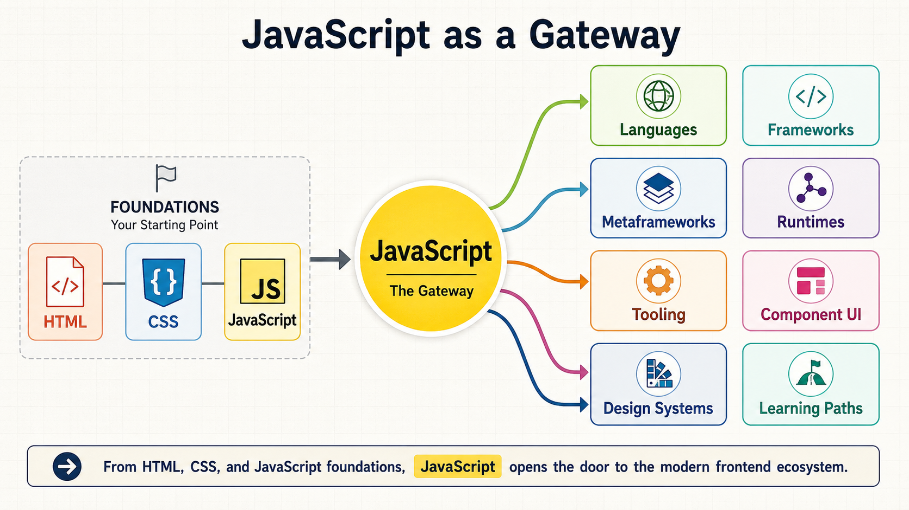
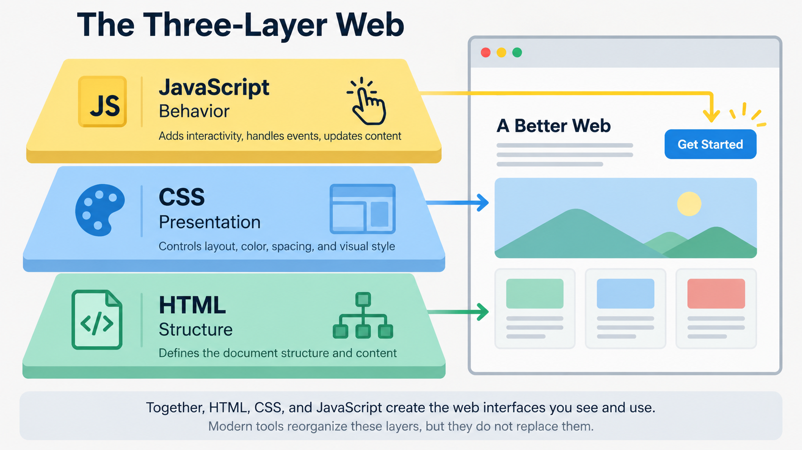
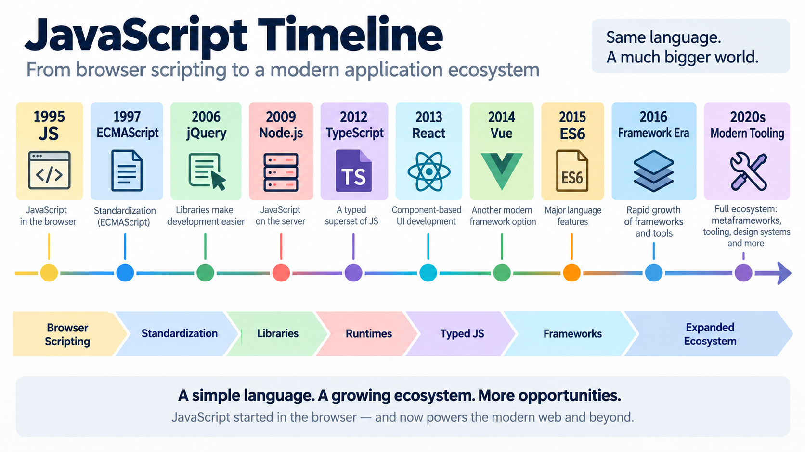
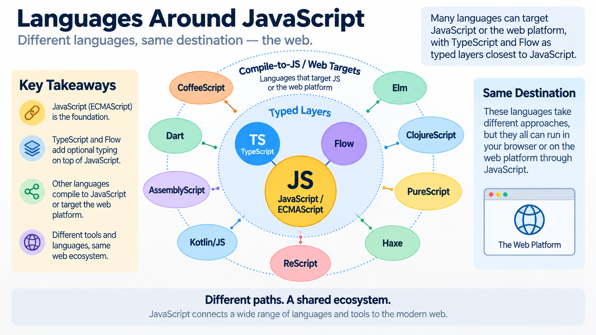
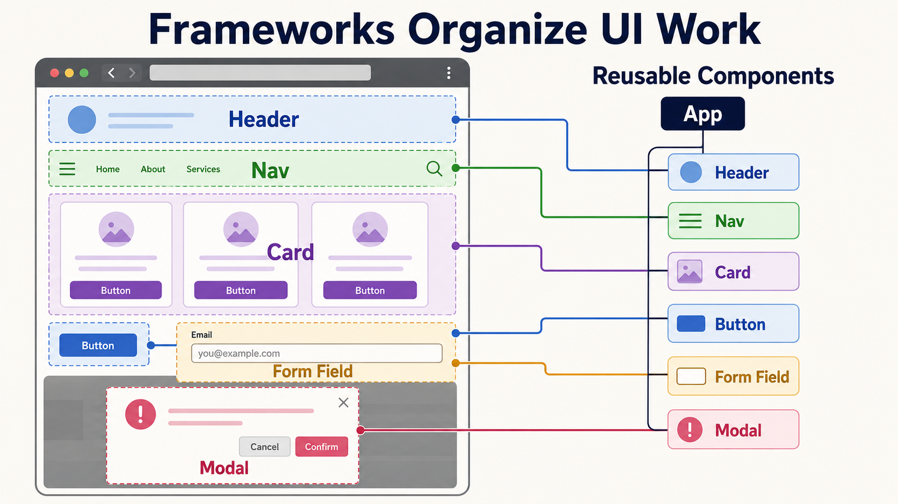
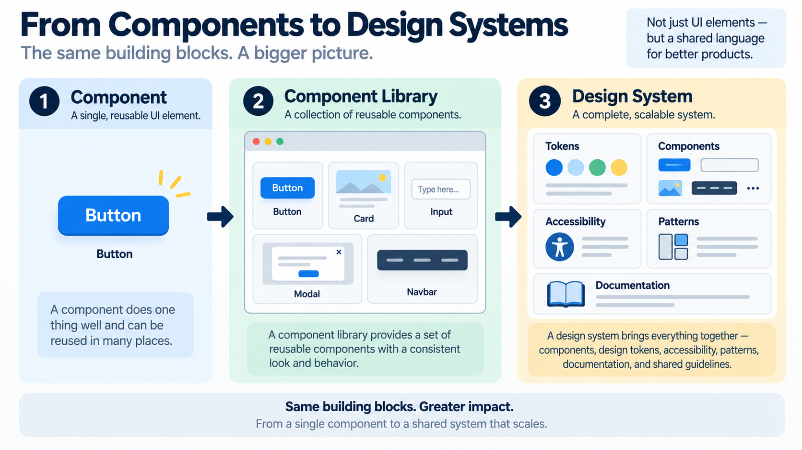
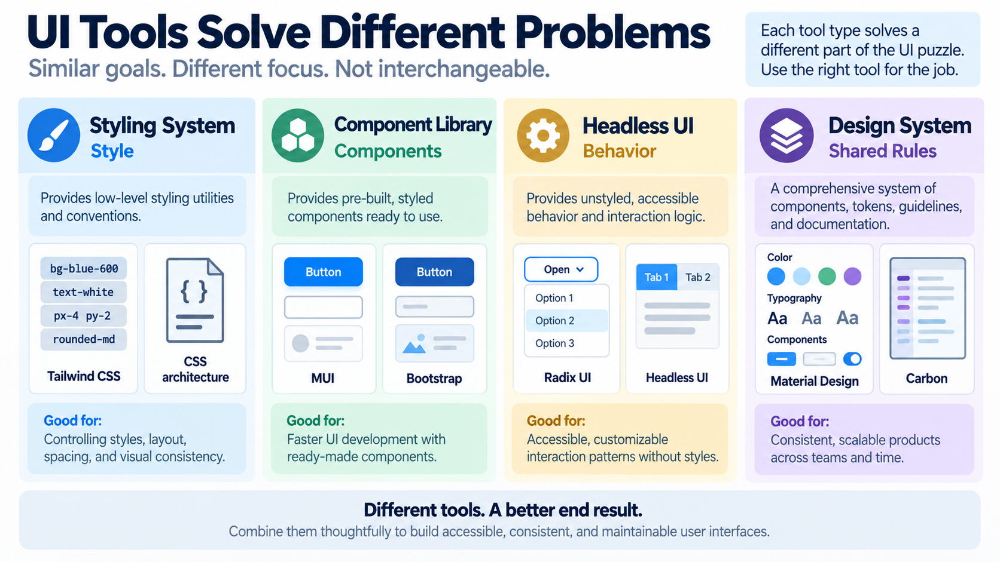
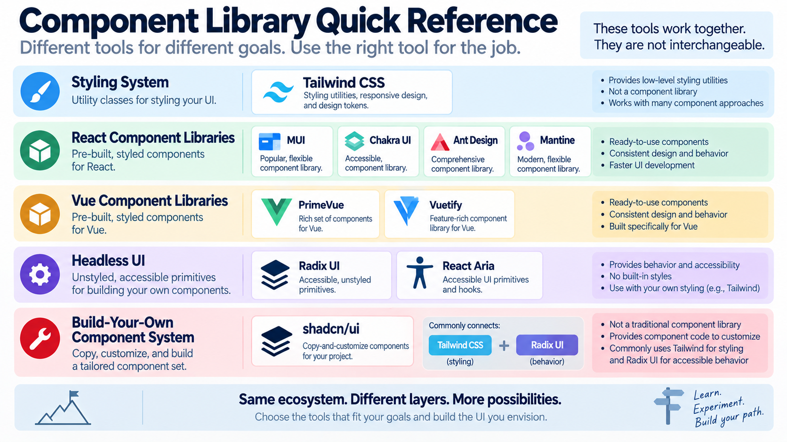
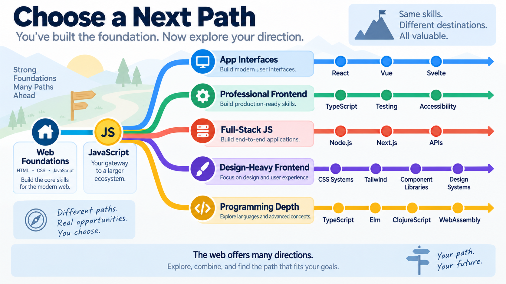
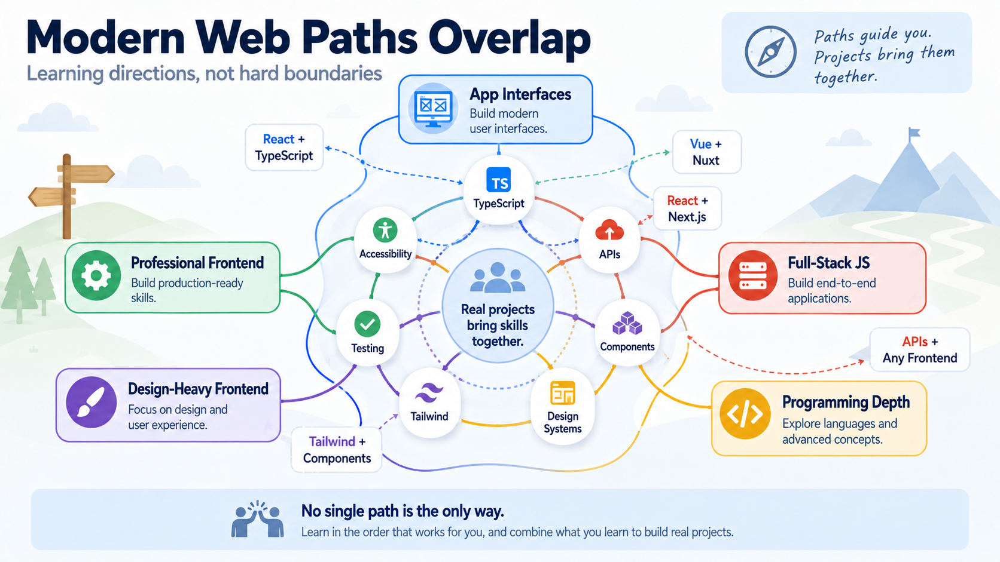

# JavaScript as a Gateway

## From Web Foundations to Modern Frontend Development

By the end of Web Development Foundations, you have learned the three foundation layers of the web:

- **HTML** gives content and structure.
- **CSS** gives presentation and layout.
- **JavaScript** gives behavior and interactivity.

Those three layers are still the starting point for modern web work. Professional developers may use frameworks, libraries, build tools, component systems, design systems, and deployment platforms, but those tools still build on the same basic foundation.

This article is not a list of everything you must learn next.

It is a map.

The goal is to help you recognize the larger landscape that JavaScript opens up. Once you understand JavaScript, many names that once looked random begin to make more sense: TypeScript, React, Vue, Angular, Node.js, Next.js, Tailwind CSS, MUI, design systems, and many others.

You do not need to learn everything next. You need to recognize the landscape and choose a next path.

---

## Figure 1 - The Map After the Foundations

*Figure 1. JavaScript begins as the behavior layer of the web, but it also connects to frameworks, languages, runtimes, tooling, UI systems, and future learning paths.*

---

# The Three-Layer Web

The web is often introduced as three connected layers.

HTML describes what exists on the page. It gives the document structure: headings, paragraphs, links, images, lists, forms, buttons, sections, navigation, and content.

CSS describes how that content is presented. It controls color, spacing, layout, typography, responsive behavior, and visual hierarchy.

JavaScript describes what can happen. It lets the page respond to user actions, update content, read input, make decisions, fetch data, store state, and connect the interface to a larger application.

That basic model remains useful even when the tools become more advanced.

React components still produce HTML. Tailwind classes still apply CSS rules. TypeScript still becomes JavaScript before it runs in most browser contexts. Next.js still sends interface code to the browser. Component libraries still render buttons, inputs, cards, menus, dialogs, and forms.

The professional ecosystem changes the way these layers are organized, but it does not erase the layers.

---

## Figure 2 - The Three-Layer Web

*Figure 2. HTML provides structure, CSS provides presentation, and JavaScript provides behavior. Modern tools reorganize these layers, but they do not replace them.*

---

# Why JavaScript Became So Important

JavaScript became important because it was placed inside the browser.

In the early web, pages were mostly static documents. A page could display information, but it could not easily respond after it loaded. JavaScript changed that. It gave the browser a programming language for interaction.

JavaScript was created at Netscape in 1995 by Brendan Eich. It was first developed quickly for use in Netscape Navigator, and it later became standardized through ECMAScript. That standardization mattered because the web needed a shared language that could work across different browsers and vendors.

Over time, JavaScript moved beyond small page scripts.

It became the language of:

- browser interactivity;
- DOM manipulation;
- frontend application frameworks;
- server-side development through runtimes such as Node.js, Deno, and Bun;
- command-line tools and build systems;
- package ecosystems such as npm;
- full-stack web frameworks;
- component-based user interface development;
- and many modern frontend workflows.

JavaScript matters because the browser matters. The browser became one of the most widely available software platforms in the world, and JavaScript became the programming language built into that platform.

That does not mean JavaScript is the only important language. It means JavaScript became a gateway language: learning it helps you understand a large part of modern software development.

# A Short JavaScript Timeline

The JavaScript ecosystem did not appear all at once. It grew in stages.

The timeline below is selective. It does not include every important tool or language. Instead, it highlights moments that help explain how JavaScript moved from page scripting into a large application ecosystem.

| Year | Milestone | Why It Mattered |
|---:|---|---|
| 1995 | JavaScript is created at Netscape | Web pages gain a built-in behavior layer. |
| 1997 | ECMAScript standard begins | JavaScript becomes connected to a formal language standard. |
| 2006 | jQuery 1.0 | Cross-browser DOM manipulation becomes easier for many developers. |
| 2009 | Node.js | JavaScript becomes practical outside the browser for servers, tools, and scripts. |
| 2009 | CoffeeScript | Developers experiment with languages that compile to JavaScript. |
| 2010 | AngularJS era begins | Large browser applications become more organized through frameworks. |
| 2011 | Dart and ClojureScript appear | More languages target web application development. |
| 2012 | TypeScript and Elm appear | Typed and functional approaches become more visible in frontend work. |
| 2013 | React and PureScript appear | Component-based UI and advanced compile-to-JS approaches gain attention. |
| 2014 | Vue appears | A progressive framework model gains traction. |
| 2015 | ES6/ES2015 | Modern JavaScript syntax and modules reshape everyday JS. |
| 2016 | Angular 2+, Next.js, Nuxt, and Svelte | The modern framework and metaframework era accelerates. |
| 2017 | AssemblyScript | TypeScript-like syntax connects to WebAssembly-oriented workflows. |
| 2020s | TypeScript, Vite, modern rendering, and design systems | Professional frontend development becomes more structured and tool-driven. |

One important pattern appears in this timeline:

JavaScript keeps expanding outward.

It begins as browser scripting. Then it becomes standardized. Then libraries simplify browser work. Then Node.js moves JavaScript to servers and tools. Then frameworks organize large interfaces. Then TypeScript adds stronger tooling and type checking. Then metaframeworks organize whole applications. Then design systems organize teams and products.

The language grew, but the way developers organize work also grew.

---

## Figure 3 - JavaScript Timeline

*Figure 3. JavaScript grew from browser scripting into a broad ecosystem for frontend, backend, tooling, and application architecture.*

---

# Languages Around JavaScript

When people say "JavaScript ecosystem," they do not always mean JavaScript alone.

Some tools are close to JavaScript. Others are separate languages that can compile to JavaScript or target the web platform. For beginning students, the most important point is not to memorize all of them. The important point is to understand why they exist.

The browser made JavaScript unavoidable for web interfaces. Because of that, many languages and tools either extend JavaScript or compile into something the browser can run.

## JavaScript and ECMAScript

JavaScript is the language developers usually name and write.

ECMAScript is the formal standard that defines the core language. In everyday conversation, people usually say JavaScript. In standards documents, specifications, and language proposals, you will often see ECMAScript.

A simple mental model:

**ECMAScript is the standard. JavaScript is the language as developers commonly use it.**

## TypeScript

TypeScript is one of the most important JavaScript-related languages for professional frontend development.

TypeScript is a typed superset of JavaScript. That means TypeScript adds features, especially static type checking, that help developers catch mistakes earlier and work more safely in larger codebases. TypeScript code is usually compiled into JavaScript before it runs.

For students, TypeScript is often the most realistic "next language" after JavaScript because it builds directly on JavaScript knowledge. It does not make JavaScript irrelevant. It rewards knowing JavaScript well.

## Other Languages That Target JavaScript or the Web

Several languages exist partly because JavaScript became the language of the browser.

Examples include:

- **CoffeeScript**: an early language that compiled to JavaScript and tried to make JS syntax more concise.
- **Dart**: a Google language used for web, server, and especially Flutter application development; Dart can compile to JavaScript for web targets.
- **Elm**: a functional language focused on reliable browser interfaces.
- **ClojureScript**: a version of Clojure that compiles to JavaScript.
- **PureScript**: a strongly typed functional language that compiles to JavaScript.
- **Haxe**: a cross-platform language that can target JavaScript along with other platforms.
- **ReScript**: a language in the ML/OCaml family designed for efficient JavaScript output.
- **Kotlin/JS**: a Kotlin target that allows Kotlin code to run in JavaScript environments.
- **AssemblyScript**: a TypeScript-like language that compiles to WebAssembly.

You do not need to learn all of these. Many professional developers never use most of them.

But knowing that they exist teaches an important lesson: the browser became such an important runtime that many languages built bridges to it.

---

## Figure 4 - Languages Around JavaScript

*Figure 4. TypeScript and compile-to-JS or web-targeting languages orbit JavaScript because the browser and web platform are major targets for software development.*

---

# Frameworks, Libraries, and Metaframeworks

Students often hear names like React, Angular, Vue, Next.js, Nuxt, and Svelte and assume they are all programming languages.

They are not.

This is one of the most useful distinctions you can learn early.

JavaScript is a programming language. TypeScript is a typed language layer that builds on JavaScript. React, Vue, Angular, Svelte, Next.js, and Nuxt are tools built with JavaScript and/or TypeScript.

They help developers organize applications.

## Libraries and Frameworks

A library or framework gives developers a way to structure common work.

In frontend development, that often means:

- organizing user interfaces;
- responding to user actions;
- updating the page when data changes;
- dividing the interface into reusable pieces;
- managing state;
- connecting the page to APIs;
- keeping large applications understandable.

Some major examples:

- **jQuery** helped developers work with the DOM more easily across browsers.
- **AngularJS** and later **Angular** provided large application frameworks.
- **React** popularized component-based UI development for many teams.
- **Vue** offered a progressive framework approach that could scale from small interactions to larger apps.
- **Svelte** used a compiler-centered approach to building reactive interfaces.

Each tool has its own philosophy, but they share a common problem: making interactive user interfaces easier to build and maintain.

## Metaframeworks

A metaframework goes beyond UI components.

It usually adds application-level structure such as:

- routing;
- page organization;
- rendering strategies;
- server-side rendering;
- static site generation;
- data loading;
- build conventions;
- deployment patterns.

Examples include:

- **Next.js** for React applications;
- **Nuxt** for Vue applications;
- **SvelteKit** for Svelte applications;
- **Remix** for web applications with strong routing and data conventions;
- **Astro** for content-focused and component-driven websites.

A simple way to remember the difference:

**React helps organize UI. Next.js helps organize a React application.**

That same pattern appears elsewhere:

**Vue helps organize UI. Nuxt helps organize a Vue application.**

**Svelte helps organize UI. SvelteKit helps organize a Svelte application.**

---

## Figure 5 - Frameworks Organize UI Work

*Figure 5. Modern frontend frameworks often organize interfaces as reusable components rather than one large page script.*

---

# From Components to Design Systems

At this point in the course, you have learned the three foundation layers of the web:

1. HTML gives content and structure.
2. CSS gives presentation and layout.
3. JavaScript gives behavior and interactivity.

Modern frontend development builds on those same foundations, but organizes them differently. Instead of thinking only in terms of separate pages, professional teams often build applications from reusable components.

That shift matters because:

1. Students first learn HTML, CSS, and JavaScript as separate foundations.
2. Then they learn that modern applications are often built from reusable components.
3. Then they see that professional teams use component libraries and design systems to avoid rebuilding common UI patterns from scratch.
4. Then they understand why frontend work is part programming, part design, and part communication.

## Components

A component is a reusable piece of interface.

Examples include:

- Button
- Card
- Navbar
- Modal
- Form field
- Product tile
- Search box
- Alert message
- Profile panel

Instead of building every page as one large file, a team can build a page from smaller parts. Those parts can be reused, tested, styled, improved, and shared.

A beginner may write one button directly in HTML.

A professional team may define a Button component with consistent styles, states, accessibility behavior, icons, loading behavior, and design rules.

The idea is the same: the user needs a button.

The system around the button becomes more organized.

## Component Libraries

A component library provides ready-made components that developers can use in applications.

Examples include:

- **MUI**
- **Chakra UI**
- **Ant Design**
- **Mantine**
- **Bootstrap**
- **PrimeVue**
- **Vuetify**

These libraries help teams avoid rebuilding common UI pieces from scratch. They often include buttons, forms, navigation, dialogs, tables, layout helpers, feedback messages, and other common patterns.

## Utility-First CSS

Tailwind CSS is often discussed alongside component libraries, but it solves a different problem.

Tailwind is a utility-first CSS framework. Instead of giving you a complete visual component such as a prebuilt button or modal, it gives you many small CSS utility classes that can be combined to create designs.

Tailwind does not mean CSS disappears. It means CSS is organized through reusable class patterns.

## Headless UI

Headless UI libraries provide behavior and accessibility without forcing a finished visual style.

Examples include:

- **Radix UI**
- **Headless UI**
- **React Aria**

These tools are useful when a team wants accessible menus, dialogs, tabs, tooltips, dropdowns, or form behaviors, but also wants to control the visual design.

## Design Systems

A design system is larger than a component library.

A design system may include:

- colors;
- typography;
- spacing;
- layout rules;
- reusable components;
- accessibility guidance;
- interaction patterns;
- writing style;
- code examples;
- design files;
- naming conventions;
- product rules.

Examples include:

- **Material Design**
- **Carbon Design System**
- **Lightning Design System**
- **Atlassian Design System**

A design system helps a team build consistent products. It turns individual UI choices into shared language.

That is why frontend work is not only programming. It is also design and communication.

---

## Figure 6 - From Components to Design Systems

*Figure 6. A single UI component can grow into a component library, and a component library can become part of a larger design system.*

---

## Figure 7 - UI Tool Comparison

*Figure 7. Tailwind, MUI, Bootstrap, Radix UI, and design systems solve different UI problems. They should not be treated as interchangeable tools.*

---

## Component Library Quick Reference

The image below is a quick visual guide, but the links in this section are the part students can actually use for exploration.

## Figure 8 - Component Library Quick Reference

*Figure 8. Component libraries, styling systems, headless UI tools, and build-your-own component systems solve related but different frontend problems.*

| Category | Tools to Explore | What to Notice |
|---|---|---|
| Styling system | [Tailwind CSS](https://tailwindcss.com/) | Utility classes for styling layouts and components |
| React component libraries | [MUI](https://mui.com/), [Chakra UI](https://chakra-ui.com/), [Ant Design](https://ant.design/), [Mantine](https://mantine.dev/) | Ready-made components for React applications |
| Vue component libraries | [PrimeVue](https://primevue.dev/), [Vuetify](https://vuetifyjs.com/) | Ready-made components for Vue applications |
| Headless UI | [Radix UI](https://www.radix-ui.com/), [React Aria](https://react-spectrum.adobe.com/react-aria/) | Behavior and accessibility primitives without fixed visual styling |
| Build-your-own component system | [shadcn/ui](https://ui.shadcn.com/) | Copy-and-customize component code, commonly connected with Tailwind CSS and Radix UI |

Tailwind CSS is important, but it is not a traditional component library. It gives developers utility classes for styling.

shadcn/ui is also easy to misclassify. It is not the same kind of tool as MUI or Bootstrap. Instead of installing a sealed library of components, developers copy component code into their own project and customize it. In many projects, shadcn/ui helps connect Tailwind-based styling with accessible component behavior from tools such as Radix UI.

# What This Means for Your Learning Path

The JavaScript ecosystem can look overwhelming because it contains many names.

That does not mean you are behind.

It means you are looking at a professional field with history, categories, competing ideas, and specialized tools.

The first goal is recognition.

When you hear a tool name, try to ask:

- Is this a language?
- Is this a library?
- Is this a framework?
- Is this a metaframework?
- Is this a runtime?
- Is this a build tool?
- Is this a styling system?
- Is this a component library?
- Is this a design system?

Those questions are often more useful than trying to memorize every logo.

Once you can categorize a tool, it becomes less mysterious.

# Suggested Next Paths

Different students may choose different next steps.

If you want to build app interfaces, explore **React**, **Vue**, or **Svelte** after you are comfortable with JavaScript basics.

If you want a common professional frontend path, learn **TypeScript** and then pair it with a major framework such as **React**.

If you want full-stack JavaScript, explore **Node.js** and a metaframework such as **Next.js**.

If you enjoy design-heavy frontend work, learn more about **CSS architecture**, **Tailwind CSS**, **component libraries**, **accessibility**, and **design systems**.

If you want programming depth, explore **TypeScript** more seriously, then look at functional or compile-to-JS languages such as **Elm**, **ClojureScript**, **PureScript**, or **ReScript**.

If you are curious about performance and lower-level web technology, learn what **WebAssembly** is and why tools such as AssemblyScript exist.

None of these paths require you to abandon the foundations.

They all build from the foundations.

---

## Figure 9 - Learning Path Map

*Figure 9. Students do not need to learn the entire ecosystem at once. They can choose a next path based on the kind of builder they want to become.*

---

## The Paths Overlap

The learning paths in Figure 9 are directions, not walls.

Real projects often combine tools from several paths:

- React can be paired with TypeScript.
- Next.js builds on React.
- Nuxt builds on Vue.
- Tailwind can style React, Vue, Svelte, Next.js, Nuxt, and many other kinds of projects.
- APIs connect frontend work to full-stack work.
- Testing and accessibility belong on every path.
- Component libraries and design systems often influence each other.

This is why categories are helpful but should not be treated as hard boundaries.

## Figure 10 - Modern Web Paths Overlap

*Figure 10. Learning paths help students choose a direction, but real projects often combine frameworks, TypeScript, APIs, styling systems, accessibility, testing, components, and design systems.*

---

# Closing Mental Model

HTML, CSS, and JavaScript are not just beginner topics.

They are the foundation under modern web work.

A professional frontend application may use TypeScript, React, Next.js, Tailwind, MUI, a component library, a design system, a build tool, a deployment platform, and several APIs. But beneath all of that, the application still depends on structure, presentation, and behavior.

That is why JavaScript is worth learning carefully.

It is not only a language for small scripts.

It is a gateway into modern software.

The goal is not to know every tool.

The goal is to understand enough of the map that your next step feels possible.

# Selected References

These sources were used to verify the historical framing and current terminology for this article:

- ECMA International. "ECMA-262 ECMAScript Language Specification." https://ecma-international.org/publications-and-standards/standards/ecma-262/
- TC39. "ECMAScript Language Specification." https://tc39.es/ecma262/
- TC39 / Ecma International. "TC39 ECMAScript Committee Scope." https://ecma-international.org/technical-committees/tc39/
- Allen Wirfs-Brock and Brendan Eich. "JavaScript: The First 20 Years." https://dl.acm.org/doi/10.1145/3386327
- jQuery Foundation. "History - jQuery." https://jquery.com/history/
- Node.js. "Node.js official site." https://nodejs.org/en
- React. "React Versions." https://react.dev/versions
- Angular. "Angular Versioning and Releases." https://angular.dev/reference/releases
- Microsoft TypeScript Team. "Announcing TypeScript 1.0." https://devblogs.microsoft.com/typescript/announcing-typescript-1-0/
- Next.js. "The React Framework for the Web." https://nextjs.org/
- Nuxt. "The Full-Stack Vue Framework." https://nuxt.com/
- Svelte. "Svelte Blog." https://svelte.dev/blog
- CoffeeScript. "CoffeeScript." https://coffeescript.org/
- Dart. "Dart programming language." https://dart.dev/
- Elm. "Elm language." https://elm-lang.org/
- Clojure. "Introducing ClojureScript." https://clojure.org/news/2011/07/22/introducing-clojurescript
- PureScript Documentation. "PureScript documentation." https://github.com/purescript/documentation
- Haxe Foundation. "History - Haxe." https://haxe.org/manual/introduction-haxe-history.html
- Haxe Foundation. "JavaScript target." https://haxe.org/manual/target-javascript.html
- ReScript. "The ReScript Programming Language." https://rescript-lang.org/
- Kotlin. "Kotlin/JavaScript." https://kotlinlang.org/docs/js-overview.html
- AssemblyScript. "Introduction." https://www.assemblyscript.org/introduction.html
- Deno. "Deno official site." https://deno.com/
- Bun. "Bun official docs." https://bun.com/docs
- Tailwind CSS. "Tailwind CSS official site." https://tailwindcss.com/
- shadcn/ui. "The Foundation for your Design System." https://ui.shadcn.com/
- MUI. "MUI official site." https://mui.com/
- Chakra UI. "Chakra UI official site." https://chakra-ui.com/
- Ant Design. "Ant Design official site." https://ant.design/
- Mantine. "Mantine official site." https://mantine.dev/
- PrimeVue. "PrimeVue official site." https://primevue.dev/
- Vuetify. "Vuetify official site." https://vuetifyjs.com/
