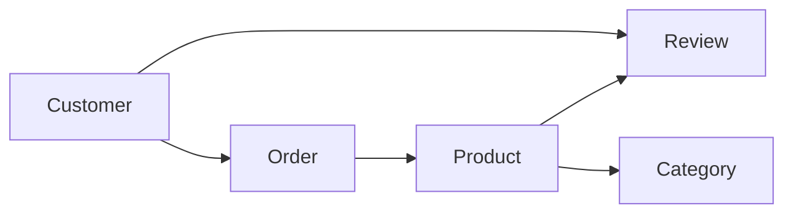

# Week 1 Lecture 1 Demo - E-commerce Conceptual Model Discovery

Course: `10-152-123 Modern Data Modeling for Systems`  
Lecture focus: Data-centric design principles  
Demo scenario: E-commerce with reviews/ratings  
Primary tangible: Conceptual model worksheet

---

# Demo Purpose

This demo shows how to move from a short system scenario into an initial conceptual model.

The goal is not to create the final model. The goal is to make early modeling thinking visible:

```text
system intent -> candidate entities -> relationship statements -> open questions
```

---

# Instructor Setup

Use this scenario:

```text
An online store lets customers browse products, place orders, and write reviews. Products are organized into categories. Store staff need to understand what information the system should remember so the store can support sales, product discovery, and customer feedback.
```

Tell students:

```text
We are not making an ERD yet. We are discovering what the system seems to care about.
```

---

# Step 1 - Manual Attempt

Create a first-pass model in front of students.

Do not make it perfect. The point is to show that a first model is supposed to be incomplete.

## Manual First-Pass Notes

System intent:

```text
The system supports customers browsing products, buying products, and leaving product feedback.
```

Candidate entities:

| Candidate Entity | Purpose |
| --- | --- |
| Customer | Person who buys products and writes reviews |
| Product | Item available for purchase |
| Order | Record of a customer purchase |
| Review | Customer feedback about a product |
| Category | Group used to organize products |

Plain-English relationships:

```text
Customer places Order.
Order includes Product.
Customer writes Review.
Product receives Review.
Product belongs to Category.
```

Open questions:

```text
1. Can an order include more than one product?
2. Can a product belong to more than one category?
3. Can a customer review the same product more than once?
```

---

# Step 2 - Optional Rough Sketch

Use a quick sketch only to show the current thinking.

This is not formal ERD notation.



Instructor note:

```text
This sketch helps us see possible relationships, but it does not yet prove cardinality, keys, or final structure.
```

---

# Step 3 - AI Critique Prompt

Show students a bounded AI prompt that asks for critique, not completion.

```text
I am creating an early conceptual data model for an e-commerce system.

Manual attempt:
- Entities: Customer, Product, Order, Review, Category
- Relationships:
  - Customer places Order
  - Order includes Product
  - Customer writes Review
  - Product receives Review
  - Product belongs to Category
- Open questions:
  - Can an order include more than one product?
  - Can a product belong to more than one category?
  - Can a customer review the same product more than once?

Do not create a final model.

Critique this first attempt for a beginning data modeling class.

Identify:
1. entities that may be missing,
2. relationships that may be ambiguous,
3. assumptions I should write down,
4. questions I should answer before making a formal ERD.

Keep the feedback introductory. Do not add advanced implementation details.
```

---

# Step 4 - Prepared AI Output Excerpt

Use a prepared output excerpt so the demo can teach judgment intentionally.

```text
Possible missing entity:
- OrderItem may be needed if an order can contain multiple products.

Ambiguous relationship:
- "Product belongs to Category" may be one category per product or multiple categories per product.

Assumption to document:
- A review appears to connect both a customer and a product.

Question to answer:
- Should staff or administrators be modeled now, or are they outside the current scope?

Potentially too advanced for now:
- Inventory movement, product recommendations, shipment tracking, and payment processing could be modeled later, but may be outside the first conceptual model.
```

---

# Step 5 - Instructor Review of AI Output

Label the AI output visibly.

| AI Suggestion | Review Label | Instructor Reasoning |
| --- | --- | --- |
| OrderItem may be needed | Verify Later | Good catch, but we need to confirm whether orders can contain multiple products before adding it. |
| Category ambiguity | Accept | This is a real modeling question and should be added to open questions. |
| Review connects customer and product | Accept | This clarifies that Review is not just text. It sits between Customer and Product. |
| Model staff/admin now | Reject for now | Staff may matter later, but this first model focuses on customer-facing sales and reviews. |
| Add inventory movement and shipments | Out of Scope | Possible future complexity, but too much for Week 1. |

---

# Step 6 - Finalized Lecture 1 Tangible

Revise the model lightly.

## Revised Entity Notes

| Entity | Purpose | Status |
| --- | --- | --- |
| Customer | Person who buys products and writes reviews | Keep |
| Product | Item available for purchase | Keep |
| Order | Purchase event made by a customer | Keep |
| Review | Feedback connecting a customer to a product | Keep |
| Category | Group used to organize products | Keep |
| OrderItem | Possible detail record if orders contain multiple products | Verify Later |

## Revised Relationship Statements

```text
Customer places Order.
Order includes Product.
Customer writes Review.
Review is about Product.
Product belongs to Category.
```

## Revised Open Questions

```text
1. Can an order include more than one product?
2. Can a product belong to more than one category?
3. Can a customer review the same product more than once?
4. Should OrderItem be modeled now or later?
5. Are staff/admin users inside this first model scope?
```

---

# Student Transfer

Students should now use `Conceptual_Model_Worksheet.md` for their selected scenario.

Reminder to students:

```text
Your model should not match the E-commerce model. Your artifact should match the same kind of thinking.
```

