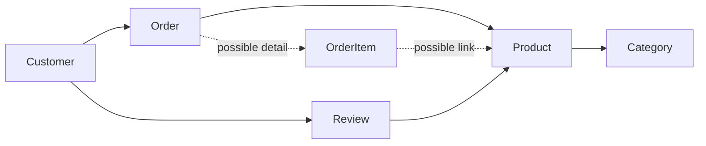

# Week 1 Lecture 1 Worked Output - E-commerce Conceptual Model Discovery

Course: `10-152-123 Modern Data Modeling for Systems`  
Demo scenario: E-commerce with reviews/ratings  
Status: Instructor worked example

---

# 1. Scenario

Selected scenario:

```text
E-commerce with reviews/ratings
```

Brief scenario summary:

```text
An online store lets customers browse products, place orders, and write reviews. Products are organized into categories. Store staff need to understand what information the system should remember so the store can support sales, product discovery, and customer feedback.
```

---

# 2. System Intent

What is this system trying to support?

```text
The system supports customers browsing products, purchasing products, and leaving feedback that helps other customers evaluate products.
```

Who uses or benefits from the information?

```text
Customers, store administrators, product managers, and possibly support staff.
```

What decisions or actions depend on the information?

```text
Customers decide what to buy. Store staff manage product listings and order records. Product managers may use review feedback to evaluate product quality.
```

---

# 3. Candidate Entities

| Candidate Entity | Thing, Person, Event, Category, or Description? | Purpose in the System | Keep, Question, or Remove? |
| --- | --- | --- | --- |
| Customer | Person | Represents someone who buys products and writes reviews | Keep |
| Product | Thing | Represents an item available for purchase | Keep |
| Order | Event | Represents a customer purchase | Keep |
| Review | Description/Event | Represents customer feedback about a product | Keep |
| Category | Category | Organizes products for browsing | Keep |
| OrderItem | Event detail | May be needed if an order includes multiple products | Question |
| StaffUser | Person | Could represent store employees who manage products | Question for later scope |

---

# 4. Plain-English Relationships

```text
1. Customer places Order.
2. Order includes Product.
3. Customer writes Review.
4. Review is about Product.
5. Product belongs to Category.
```

---

# 5. Open Modeling Questions

```text
1. Can an order include more than one product?
2. Can a product belong to more than one category?
3. Can a customer review the same product more than once?
4. Should OrderItem be modeled now or later?
5. Are staff/admin users inside this first model scope?
```

---

# 6. Optional Manual Sketch

This sketch is not formal ERD notation.



---

# 7. AI Assistance Notes

## Manual Work Completed Before AI

```text
I wrote the system intent, initial candidate entity list, relationship statements, and open modeling questions before asking AI for critique.
```

## Prompt Used

```text
I am creating an early conceptual data model for an e-commerce system.

Manual attempt:
- Entities: Customer, Product, Order, Review, Category
- Relationships:
  - Customer places Order
  - Order includes Product
  - Customer writes Review
  - Product receives Review
  - Product belongs to Category
- Open questions:
  - Can an order include more than one product?
  - Can a product belong to more than one category?
  - Can a customer review the same product more than once?

Do not create a final model.

Critique this first attempt for a beginning data modeling class.

Identify:
1. entities that may be missing,
2. relationships that may be ambiguous,
3. assumptions I should write down,
4. questions I should answer before making a formal ERD.

Keep the feedback introductory. Do not add advanced implementation details.
```

## Most Useful AI Suggestion

```text
AI suggested that OrderItem may be needed if orders can contain multiple products.
```

Why was it useful?

```text
It revealed that "Order includes Product" may be too simple. The model may need a detail record later.
```

## Suggestion I Rejected

```text
AI suggested considering inventory movement, shipment tracking, and product recommendations.
```

Why did you reject it?

```text
Those may be real system concerns, but they are outside the first conceptual model for Week 1.
```

## Change I Made After Reviewing AI

```text
I added OrderItem as a question rather than a confirmed entity and rewrote "Product receives Review" as "Review is about Product."
```

## What I Verified Myself

```text
I verified that each kept entity connects to the system intent of browsing, purchasing, or reviewing products.
```

