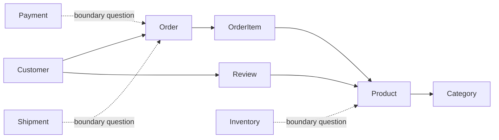

# Week 1 Lecture 2 Demo - E-commerce Model Quality Revision

Course: `10-152-123 Modern Data Modeling for Systems`  
Lecture focus: Model quality and evaluation  
Demo scenario: E-commerce with reviews/ratings  
Primary tangible: Quality review and revised conceptual model

---

# Demo Purpose

This demo shows how to review and improve an early conceptual model without overbuilding it.

The movement is:

```text
initial model -> manual quality review -> AI critique -> instructor review -> revised model
```

The goal is not to add every possible feature. The goal is to improve clarity, usefulness, and readiness for Week 2 relational structure.

---

# Starting Point

Use the Lecture 1 worked output as the starting model.

Current kept entities:

```text
Customer
Product
Order
Review
Category
```

Current questioned entities:

```text
OrderItem
StaffUser
```

Current relationships:

```text
Customer places Order.
Order includes Product.
Customer writes Review.
Review is about Product.
Product belongs to Category.
```

---

# Step 1 - Manual Quality Review

Review the model using simple quality lenses.

| Quality Lens | Instructor Notes |
| --- | --- |
| Clarity | The model clearly supports browsing, ordering, and reviewing. |
| Usefulness | It identifies the main business objects and events. |
| Flexibility | Product-category and order-product relationships may need more detail later. |
| Missing Information | Payment, shipment, inventory, and staff users are not included. |
| Ambiguity | Order includes Product is too vague if orders can contain multiple products. |

Instructor talk track:

```text
Notice that "missing information" does not always mean "add it now." Sometimes the right move is to document the boundary and keep the model focused.
```

---

# Step 2 - AI Critique Prompt

Use a prompt that asks AI to critique quality, not produce a final design.

```text
I have an early conceptual model for an e-commerce system.

System intent:
Customers browse products, place orders, and write reviews.

Current entities:
Customer, Product, Order, Review, Category

Questioned entities:
OrderItem, StaffUser

Current relationships:
- Customer places Order
- Order includes Product
- Customer writes Review
- Review is about Product
- Product belongs to Category

Critique the quality of this early conceptual model.

Do not create a full ERD or final database design.

Evaluate:
1. clarity,
2. usefulness,
3. flexibility,
4. missing information,
5. ambiguity,
6. whether any suggested additions are too advanced or out of scope for Week 1.

Keep the critique appropriate for beginning data modeling students.
```

---

# Step 3 - Prepared AI Output Excerpt

```text
Clarity:
The main entities are understandable and connected to the stated system intent.

Useful revision:
OrderItem should probably be added if the course wants to show that one order can contain multiple products.

Ambiguity:
"Product belongs to Category" may need clarification. Products may belong to one category or multiple categories.

Missing information:
Payment, Shipment, Inventory, and StaffUser may be important in a real e-commerce system.

Scope warning:
Adding Payment, Shipment, Inventory, and StaffUser now may make the Week 1 model too complex. They can be documented as future boundary questions.
```

---

# Step 4 - Instructor Review Labels

| AI Output Item | Review Label | Reason |
| --- | --- | --- |
| Main entities are understandable | Accept | Confirms the model is good enough to refine, not restart. |
| Add OrderItem | Modify | We will not fully design it yet, but we will move it from "question" to "likely needed." |
| Clarify Product-Category | Accept | This is an important relationship question. |
| Add Payment, Shipment, Inventory, StaffUser | Verify Later | Realistic, but not needed for the first conceptual model. |
| Scope warning | Accept | Useful reminder to avoid overbuilding. |

---

# Step 5 - Final Revision

Make a small, justified revision.

## Revised Entity Decision

| Entity | Status | Reason |
| --- | --- | --- |
| Customer | Keep | Needed for orders and reviews |
| Product | Keep | Central item being sold and reviewed |
| Order | Keep | Purchase event |
| OrderItem | Add as likely entity | Needed if one order contains multiple products |
| Review | Keep | Customer feedback about products |
| Category | Keep | Product browsing and organization |
| StaffUser | Boundary question | May matter later but outside Week 1 model |
| Payment | Boundary question | Important but not needed for first conceptual model |
| Shipment | Boundary question | Important but not needed for first conceptual model |
| Inventory | Boundary question | Important but not needed for first conceptual model |

## Revised Relationship Statements

```text
Customer places Order.
Order contains OrderItem.
OrderItem refers to Product.
Customer writes Review.
Review is about Product.
Product belongs to Category.
```

## Revised Open Questions

```text
1. Can a product belong to multiple categories?
2. Can a customer review the same product more than once?
3. Are payment, shipment, and inventory inside this course model or outside the current boundary?
4. Are staff/admin users part of the first model or a later extension?
```

---

# Step 6 - Optional Revised Sketch

This sketch is still conceptual, not a formal ERD.



---

# Student Transfer

Students should revise their own conceptual model using the same pattern:

```text
manual quality review -> AI critique if allowed -> review labels -> final revision note
```

Students should not add every AI suggestion. They should decide what fits the current assignment scope.

