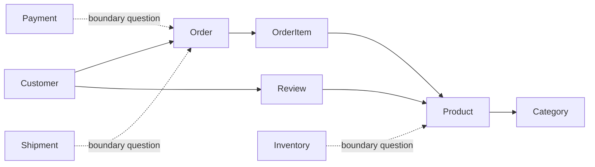

# Week 1 Lecture 2 Worked Output - E-commerce Quality Revision

Course: `10-152-123 Modern Data Modeling for Systems`  
Demo scenario: E-commerce with reviews/ratings  
Status: Instructor worked example

---

# 1. Starting Model

System intent:

```text
The system supports customers browsing products, purchasing products, and leaving feedback that helps other customers evaluate products.
```

Current entities:

```text
Customer
Product
Order
Review
Category
```

Questioned entities:

```text
OrderItem
StaffUser
```

Current relationship statements:

```text
Customer places Order.
Order includes Product.
Customer writes Review.
Review is about Product.
Product belongs to Category.
```

---

# 2. Manual Quality Review

| Quality Lens | Notes |
| --- | --- |
| Clarity | The model is understandable and connected to the system intent. |
| Usefulness | The model supports the main ideas of browsing, ordering, and reviewing. |
| Flexibility | The model may need a better way to represent orders with multiple products. |
| Missing Information | Payment, shipment, inventory, and staff/admin users may matter later. |
| Ambiguity | Product-category and order-product relationships need clarification. |

---

# 3. AI Assistance Notes

## Manual Work Completed Before AI

```text
I completed the first conceptual model and a manual quality review before asking AI for critique.
```

## Prompt Used

```text
I have an early conceptual model for an e-commerce system.

System intent:
Customers browse products, place orders, and write reviews.

Current entities:
Customer, Product, Order, Review, Category

Questioned entities:
OrderItem, StaffUser

Current relationships:
- Customer places Order
- Order includes Product
- Customer writes Review
- Review is about Product
- Product belongs to Category

Critique the quality of this early conceptual model.

Do not create a full ERD or final database design.

Evaluate:
1. clarity,
2. usefulness,
3. flexibility,
4. missing information,
5. ambiguity,
6. whether any suggested additions are too advanced or out of scope for Week 1.

Keep the critique appropriate for beginning data modeling students.
```

## Most Useful AI Suggestion

```text
AI suggested that OrderItem should probably be added if the model needs to represent one order containing multiple products.
```

Why was it useful?

```text
It helped clarify that "Order includes Product" hides an important relationship pattern.
```

## Suggestion I Rejected

```text
AI suggested that Payment, Shipment, Inventory, and StaffUser may be important.
```

Why did you reject it?

```text
I did not reject them as real system concepts. I rejected adding them to the Week 1 core model because they would overbuild the first assignment.
```

## Change I Made After Reviewing AI

```text
I moved OrderItem from "question" to "likely entity" and marked Payment, Shipment, Inventory, and StaffUser as boundary questions.
```

## What I Verified Myself

```text
I verified that the revised model still supports the original system intent without expanding into a full e-commerce platform design.
```

---

# 4. Revised Entity Decisions

| Entity | Status | Reason |
| --- | --- | --- |
| Customer | Keep | Needed for orders and reviews |
| Product | Keep | Central item being sold and reviewed |
| Order | Keep | Purchase event |
| OrderItem | Add as likely entity | Needed if one order contains multiple products |
| Review | Keep | Customer feedback about products |
| Category | Keep | Product browsing and organization |
| StaffUser | Boundary question | May matter later but outside the Week 1 core model |
| Payment | Boundary question | Important in real systems but outside the first conceptual model |
| Shipment | Boundary question | Important in real systems but outside the first conceptual model |
| Inventory | Boundary question | Important in real systems but outside the first conceptual model |

---

# 5. Revised Relationship Statements

```text
Customer places Order.
Order contains OrderItem.
OrderItem refers to Product.
Customer writes Review.
Review is about Product.
Product belongs to Category.
```

---

# 6. Revised Open Questions

```text
1. Can a product belong to multiple categories?
2. Can a customer review the same product more than once?
3. Are payment, shipment, and inventory inside this course model or outside the current boundary?
4. Are staff/admin users part of the first model or a later extension?
```

---

# 7. Revised Conceptual Sketch

This sketch is still conceptual, not formal ERD notation.



---

# 8. Current Model Limit

What does this model currently make easier?

```text
It makes the main customer-facing flow easier to discuss: customers order products and write reviews about products.
```

What does this model not yet answer?

```text
It does not yet fully answer payment, shipment, inventory, staff management, or exact product-category rules.
```

