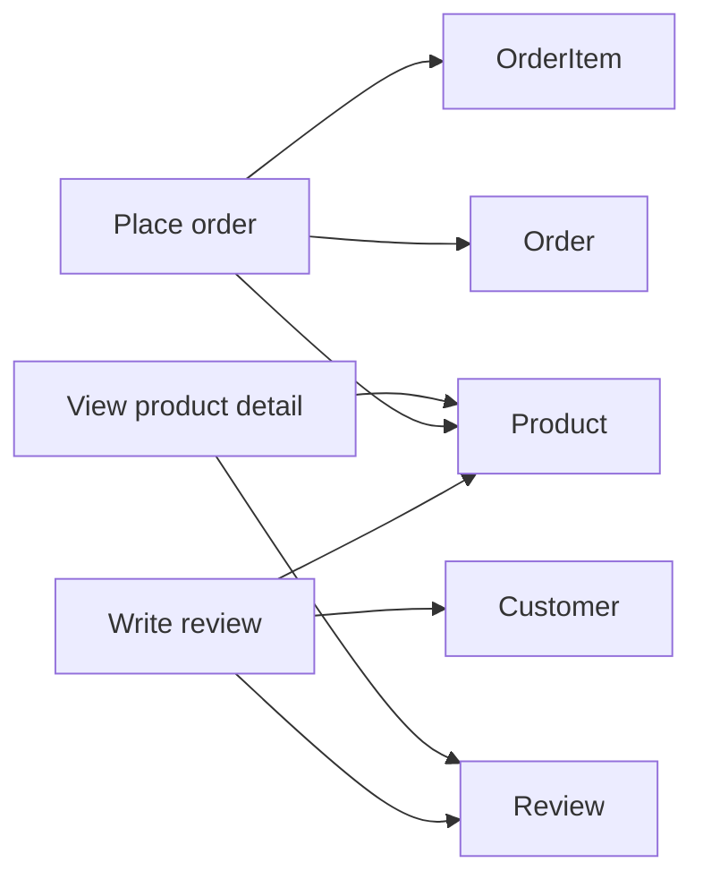

# Week 2 Lecture 2 Demo - E-commerce Process Mapping

Course: `10-152-123 Modern Data Modeling for Systems`  
Lecture focus: Data-process connection  
Demo scenario: E-commerce with reviews/ratings  
Primary tangible: Process-to-data map and process-driven revision

---

# Demo Purpose

This demo shows that a relational structure should support system behavior.

The movement is:

```text
system action -> data needed -> entities involved -> relationship tested -> model revision
```

---

# Starting Point

Use the Week 2 Lecture 1 relational structure.

Current entities:

```text
Customer
Product
Order
OrderItem
Review
Category
```

---

# Step 1 - Manual Process-to-Data Map

Map several system actions to the data they need.

| System Action or Process | Data Needed | Entities Involved | Relationship or Constraint Tested | Gap or Revision Found |
| --- | --- | --- | --- | --- |
| Customer views product detail | product name, description, current price, category, reviews | Product, Category, Review, Customer | Product-Category, Product-Review, Review-Customer | Need review date and rating visible |
| Customer places order | customer, selected products, quantities, purchase-time prices, order date | Customer, Order, OrderItem, Product | Customer-Order, Order-OrderItem, OrderItem-Product | OrderItem is necessary |
| Customer writes review | customer, product, rating, comment, review date | Customer, Product, Review | Review must connect Customer and Product | Need rule for duplicate reviews |

Instructor note:

```text
This is where the model meets reality. If a common system action cannot be explained by the model, the model needs revision or a boundary note.
```

---

# Step 2 - AI Critique Prompt

```text
Here is a process-to-data map for an e-commerce model.

Current entities:
Customer, Product, Order, OrderItem, Review, Category

Mapped processes:
1. Customer views product detail.
2. Customer places order.
3. Customer writes review.

For each process, I listed data needed, entities involved, and relationships tested.

Critique the process-to-data map.

Do not rewrite the full model.

Identify:
1. system actions that may require missing data,
2. relationships that are being tested by the process,
3. constraints or rules I should state in plain language,
4. one reasonable revision or boundary question.

Keep feedback introductory and focused on data modeling.
```

---

# Step 3 - Prepared AI Output Excerpt

```text
Possible missing data:
- Viewing product detail may require product availability or inventory status, but that may be outside current scope.

Relationship tested:
- Placing an order confirms that OrderItem is needed between Order and Product.

Constraint:
- A review should likely require both a customer and a product.

Rule question:
- Decide whether a customer can review the same product more than once.

Boundary question:
- Payment and shipment are important to real ordering, but can remain outside the current model if the course scope is data modeling foundations.
```

---

# Step 4 - Instructor Review Labels

| AI Output Item | Review Label | Reason |
| --- | --- | --- |
| Product availability may matter | Verify Later | Good real-world concern, but inventory remains outside current scope. |
| OrderItem is confirmed by ordering process | Accept | This process proves why OrderItem belongs. |
| Review requires customer and product | Accept | This becomes an integrity constraint. |
| Duplicate review rule | Accept | This is a business rule question that affects the model. |
| Payment/shipment boundary | Accept | Important but outside the current Week 2 model. |

---

# Step 5 - Final Process-Driven Revision

## Revision Made

```text
OrderItem remains in the model as a required entity because the place-order process needs to store multiple products, quantities, and purchase-time item prices inside one order.
```

## Added Constraints

```text
1. A review must connect one customer to one product.
2. A review must include a rating in the allowed range.
3. The model needs a rule decision about whether a customer can review the same product more than once.
4. Payment, shipment, and inventory are boundary questions, not part of the current model.
```

## Remaining Modeling Question

```text
Should products be limited to one category, or should products support multiple categories?
```

---

# Optional Rough Process Sketch

This is not an ERD.



---

# Student Transfer

Students should now add a process-to-data map to their A2 submission.

Reminder:

```text
If your process map reveals a model gap, document the gap and make one focused revision. Do not rebuild the whole model.
```

