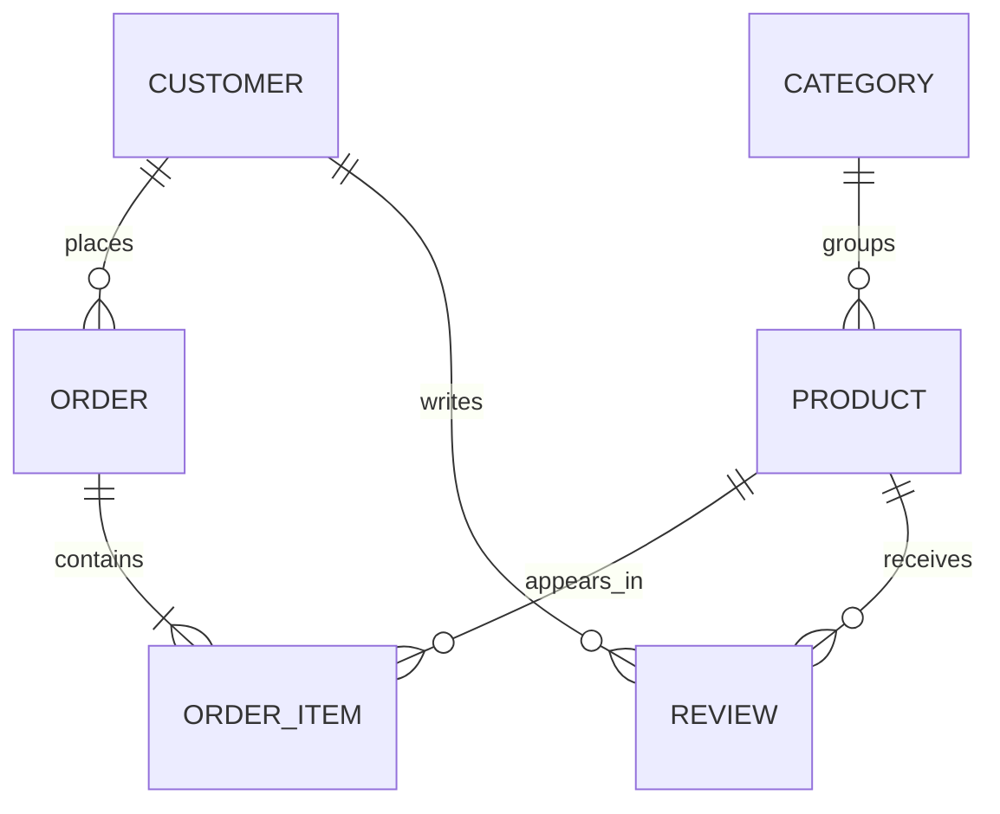

# Week 3 Lecture 1 Worked Output - E-commerce ERD Notation

Course: `10-152-123 Modern Data Modeling for Systems`  
Scenario: E-commerce with reviews/ratings

---

# ERD Planning Table

| Entity | Key Attribute | Important Attributes to Show | Relationship Lines Needed | Notes |
| --- | --- | --- | --- | --- |
| Customer | customer_id | name, email | Customer-Order, Customer-Review | Every order has a customer in this model |
| Product | product_id | name, price | Product-OrderItem, Product-Review, Category-Product | Multi-category products are out of scope |
| Order | order_id | order_date, status | Customer-Order, Order-OrderItem | Stored total is not modeled yet |
| OrderItem | order_item_id | quantity, item_price | Order-OrderItem, Product-OrderItem | Resolves Order/Product many-to-many |
| Review | review_id | rating, comment, review_date | Customer-Review, Product-Review | Duplicate review rule unresolved |
| Category | category_id | category_name | Category-Product | First version assumes one product has one category |

---

# Cardinality Decisions

| Relationship | Cardinality | Meaning |
| --- | --- | --- |
| Customer to Order | one-to-many | A customer may place many orders; each order belongs to one customer. |
| Order to OrderItem | one-to-many | An order contains one or more order items. |
| Product to OrderItem | one-to-many | A product may appear in many order items. |
| Customer to Review | one-to-many | A customer may write many reviews. |
| Product to Review | one-to-many | A product may receive many reviews. |
| Category to Product | one-to-many | A category may group many products; each product has one category in this version. |

---

# Mermaid Sample Output

This is a sample exposure artifact, not the required Week 3 tool.



---

# Assumptions to Carry into draw.io

```text
1. Guest checkout is outside the current model.
2. Product-to-category is one-to-many for this first ERD.
3. OrderItem is required because the Order/Product relationship has quantity and purchase-time price.
4. A review must connect to both a customer and a product.
5. Payment, shipment, and inventory remain outside the Week 3 diagram.
```

---

# Layout Plan

```text
Customer    Order    OrderItem    Product    Category
   |                         \        |
   |                          \       |
 Review ---------------------- Product
```

Instructor note:

```text
This rough layout is intentionally not the final ERD. It gives students a placement strategy before they open draw.io.
```

