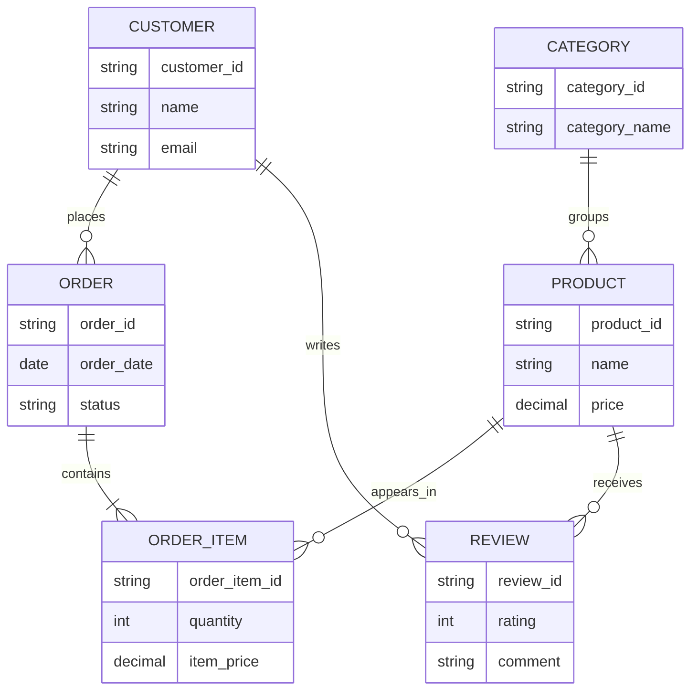

# Week 3 Lecture 1 Demo - E-commerce ERD Notation and Tool Exposure

Course: `10-152-123 Modern Data Modeling for Systems`  
Lecture focus: ERD fundamentals and notation  
Demo scenario: E-commerce with reviews/ratings  
Primary tangible: ERD plan and sample diagram outputs

---

# Demo Purpose

This demo shows how to move from a relational structure table into an ERD.

The movement is:

```text
entities and relationships -> ERD notation -> readable visual structure -> assumptions
```

The goal is not to make a beautiful diagram. The goal is to make a model visible enough that another person can inspect it.

---

# Starting Point from Week 2

Current E-commerce entities:

```text
Customer
Product
Order
OrderItem
Review
Category
```

Current relationship links:

```text
Customer places Order.
Order contains OrderItem.
OrderItem refers to Product.
Customer writes Review.
Review is about Product.
Category groups Product.
```

Known assumptions and questions:

```text
1. One order belongs to one customer.
2. One order can contain many order items.
3. One product can appear in many order items.
4. One review connects one customer to one product.
5. Product-to-category may be one-to-many now, but could become many-to-many later.
```

---

# Step 1 - Manual ERD Planning

Before opening a tool, create a planning table.

| Entity    | Key Attribute | Important Attributes to Show | Relationship Lines Needed                           | Notes                             |
| --------- | ------------- | ---------------------------- | --------------------------------------------------- | --------------------------------- |
| Customer  | customer_id   | name, email                  | Customer-Order, Customer-Review                     | Email may need unique rule later  |
| Product   | product_id    | name, price                  | Product-OrderItem, Product-Review, Product-Category | Category assumption matters       |
| Order     | order_id      | order_date, status           | Customer-Order, Order-OrderItem                     | Total is not shown as stored yet  |
| OrderItem | order_item_id | quantity, item_price         | Order-OrderItem, Product-OrderItem                  | Associative/event-like line item  |
| Review    | review_id     | rating, comment, review_date | Customer-Review, Product-Review                     | Duplicate review rule unresolved  |
| Category  | category_id   | category_name                | Category-Product                                    | Use one-to-many for first version |

---

# Step 2 - Manual Notation Decisions

| Relationship         | Cardinality Decision | Plain-English Meaning                                                  | Assumption                                                |
| -------------------- | -------------------- | ---------------------------------------------------------------------- | --------------------------------------------------------- |
| Customer to Order    | one-to-many          | One customer may place many orders; each order belongs to one customer | Guest checkout is out of scope                            |
| Order to OrderItem   | one-to-many          | One order contains one or more line items                              | Empty orders are not meaningful                           |
| Product to OrderItem | one-to-many          | One product can appear in many line items                              | Product records remain after purchase                     |
| Customer to Review   | one-to-many          | One customer may write many reviews                                    | Review must have an author                                |
| Product to Review    | one-to-many          | One product may receive many reviews                                   | Review must target one product                            |
| Category to Product  | one-to-many          | One category groups many products                                      | Multi-category products are out of scope for this version |

---

# Step 3 - Tool Output Exposure

Show students that different tools can express the same model with different strengths.

## draw.io / diagrams.net

Use for the main classroom demo.

```text
Strengths:
- Visual, flexible, free, easy to export
- Good for manual ERD layout practice

Watch for:
- Students can draw lines that look good but do not mean anything
- File/export management matters
```

## Mermaid ER Diagram Sample

Mermaid is useful for showing that diagrams can also be text-based.



Instructor note:

```text
Mermaid is not the required classroom tool, but it helps students see how notation choices encode relationships.
```

## Other Tools to Mention Briefly

| Tool            | Useful For                          | Course 123 Caution                                           |
| --------------- | ----------------------------------- | ------------------------------------------------------------ |
| Lucidchart      | Polished diagrams and templates     | Avoid overusing decoration or auto-generated schema features |
| Miro or FigJam  | Collaborative whiteboarding         | ERD notation may need manual discipline                      |
| ERDPlus         | Simple database-design diagrams     | Do not export scripts for this course                        |
| Visual Paradigm | Formal modeling environments        | Can be too feature-heavy for Week 3                          |
| Creately        | Quick diagramming and collaboration | Check notation consistency                                   |

---

# Step 4 - AI Critique Prompt

AI should critique the relationship plan before or after the draft. It should not create the diagram for students.

```text
Here is my ERD plan for an introductory data modeling course.

Entities:
Customer, Product, Order, OrderItem, Review, Category

Relationships:
- Customer places Order
- Order contains OrderItem
- Product appears in OrderItem
- Customer writes Review
- Product receives Review
- Category groups Product

Assumptions:
- Guest checkout is out of scope.
- Empty orders are not meaningful.
- Each review connects one customer to one product.
- Product-to-category is one-to-many for this version.

Critique this ERD plan before I draw it.

Do not create the diagram for me.

Identify:
1. cardinality decisions I should double-check,
2. possible many-to-many relationships,
3. places where an associative entity may be needed,
4. assumptions that should be written next to the diagram,
5. layout advice that would make the diagram easier to read.
```

---

# Step 5 - Prepared AI Output Excerpt

```text
Cardinality to double-check:
- Category to Product may be many-to-many if products can belong to several categories.

Associative entity:
- OrderItem is appropriate because Order and Product are many-to-many through line items, and the relationship has attributes like quantity and item_price.

Assumption to document:
- Guest checkout is excluded, so every Order must connect to a Customer.

Layout advice:
- Place OrderItem between Order and Product so readers can see why it exists.
- Place Review between Customer and Product or near Product with visible links to both.
```

---

# Step 6 - Instructor Review Labels

| AI Suggestion                             | Review Label         | Instructor Reasoning                                |
| ----------------------------------------- | -------------------- | --------------------------------------------------- |
| Revisit Category/Product                  | Accept as assumption | We will keep one-to-many but document the choice.   |
| Keep OrderItem as associative entity      | Accept               | This is a central ERD learning moment.              |
| Document guest checkout exclusion         | Accept               | This clarifies optionality.                         |
| Place OrderItem between Order and Product | Accept               | Layout should reveal model meaning.                 |
| Let AI draw the diagram                   | Reject               | Students need tool practice and notation ownership. |

---

# Step 7 - Student Transfer

Students should now create an ERD plan for their selected scenario before spending the lab period in draw.io.

Transfer bridge:

```text
In the demo, we turned relationship statements into visible cardinality decisions.
In your lab, you will turn your A2 relationship table into a first ERD using the same kind of planning.
```
