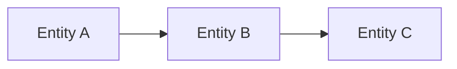

# Conceptual Model Worksheet

Course: `10-152-123 Modern Data Modeling for Systems`  
Assignment: `A1 Conceptual Model Start and Quality Revision`

---

# Purpose

Use this worksheet to create an early conceptual model.

At this stage, you are not creating a database schema, ERD, SQL script, or MongoDB document model. You are identifying what the system needs to remember, relate, and question.

---

# 1. Scenario

Selected scenario:

```text

```

Brief scenario summary:

```text

```

---

# 2. System Intent

What is this system trying to support?

```text

```

Who uses or benefits from the information?

```text

```

What decisions or actions depend on the information?

```text

```

---

# 3. Candidate Entities

List possible things, people, events, categories, or records the system may need to remember.

| Candidate Entity | Thing, Person, Event, Category, or Description? | Purpose in the System | Keep, Question, or Remove? |
| --- | --- | --- | --- |
|  |  |  |  |
|  |  |  |  |
|  |  |  |  |
|  |  |  |  |
|  |  |  |  |

---

# 4. Plain-English Relationships

Write relationships as simple sentences.

Examples:

```text
Customer places Order.
Product receives Review.
Book is checked out by Patron.
```

Your relationship statements:

```text
1.
2.
3.
4.
5.
```

---

# 5. Open Modeling Questions

Write questions you need to answer before the model can become more formal.

```text
1.
2.
3.
```

Optional additional questions:

```text
4.
5.
```

---

# 6. Optional Manual Sketch

You may use a rough hand sketch, text sketch, or Mermaid sketch.

Do not worry about formal notation yet.



Replace this with your own rough sketch if useful.

---

# 7. Quality Review

Complete this after the second Week 1 lecture.

| Quality Lens | Notes |
| --- | --- |
| Clarity: Can another person understand the basic system intent? |  |
| Usefulness: Does the model help explain what the system remembers? |  |
| Flexibility: Is the model too narrow or too rigid already? |  |
| Missing Information: What important information may be absent? |  |
| Ambiguity: What is still unclear? |  |

---

# 8. Revision Note

What did you change after reviewing model quality?

```text

```

Why did you make that change?

```text

```

---

# 9. Current Model Limit

What does this model currently make easier?

```text

```

What does this model not yet answer?

```text

```

