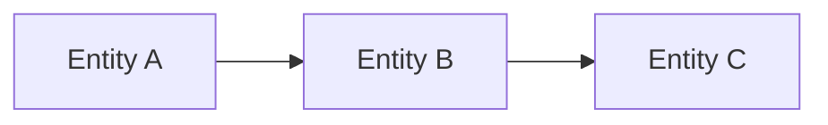

# Optional Conceptual Sketch

Course: `10-152-123 Modern Data Modeling for Systems`  
Week: `01`  
Assignment: `A1 Conceptual Model Start and Quality Revision`

---

# Purpose

This file is optional.

Use it if a rough sketch helps you think through your early conceptual model.

This is not a formal ERD. You do not need cardinality, keys, or formal notation yet.

You may use:

- a plain text sketch
- a Mermaid sketch
- a screenshot/photo of a hand sketch, if allowed by your instructor

---

# Plain Text Sketch

```text

```

---

# Optional Mermaid Sketch

Replace the placeholder entities with your own.



---

# Sketch Notes

What does this sketch help you see?

```text

```

What is still uncertain?

```text

```

